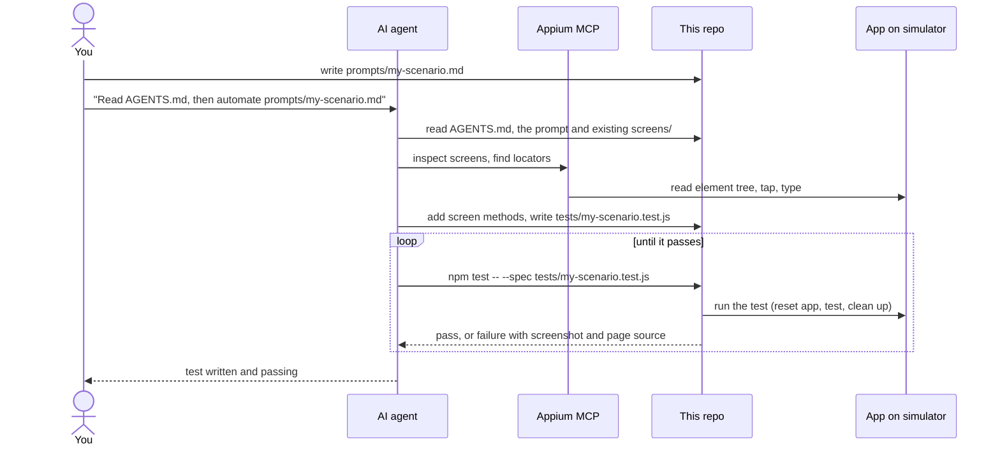

# Appium MCP Mobile Test Harness

Describe a mobile scenario in Markdown, then ask an AI coding agent to inspect the app through Appium MCP and write a reusable WebdriverIO test. Review and rerun the saved test independently of the agent. The examples cover Apple Contacts on iOS and Google Contacts on Android.

[](https://github.com/yashwant-das/ai-js-appium-mcp/actions/workflows/lint.yml)
[](LICENSE)
[](https://webdriver.io)
[](https://appium.io)
[](https://nodejs.org)

## What it demonstrates

- **Two platforms, one scenario:** four [Contacts tests](tests/) share screen APIs while [screen objects](screens/) contain platform locators and navigation differences.
- **Inspectable test authoring:** [Markdown prompts](prompts/) provide requirements; the agent uses [Appium MCP](docs/appium-mcp.md) to inspect real screens before generating code. There is no custom parser or test DSL.
- **Repeatable execution:** [app-state recovery](support/appState.js), [unique contact data](support/testData.js) and [reverse-order cleanup](support/cleanup.js) reduce interference between runs. Cleanup is best effort; persistent app data is retained.
- **Reviewable agent output:** [ESLint rules](eslint.config.js) reject raw selectors in tests, unawaited assertions, pauses and debug calls. Assertions stay in tests; locators and actions stay in screens.
- **Failure evidence:** [hooks](support/hooks.js) save screenshots and page source to disk and attach them to Allure alongside cleanup warnings.

The cross-platform implementation is present; full-suite stability validation remains [pending](docs/roadmap.md). Historical individual Android passes do not establish that every scenario passes on every device.

## Architecture



### Who does what

| Who | What they do |
| --- | --- |
| **You** | Boot a simulator or emulator, start Appium, write the scenario as a Markdown file in `prompts/`, ask the agent to automate it, review what it wrote. |
| **AI agent** (Claude Code, Cursor, OpenCode, Gemini CLI, …) | Follows [AGENTS.md](AGENTS.md): reads your scenario, looks at the running app through Appium MCP, writes screen-object methods and the test, runs it with `npm test`, and fixes it until it passes. |
| **[Appium MCP](https://github.com/appium/appium-mcp)** | The agent's eyes and hands while it writes a test: it reads the screen's element tree, suggests locators, taps and types. By default it drives the simulator with its own bundled drivers. It is only used while a test is being written, never when tests run. |
| **This framework** | Makes tests reliable and repeatable: one config for the app and device, screen objects that hold every locator, a reset to the app's home screen before each test, unique test data that is deleted afterwards, failure screenshots, an Allure report and lint rules for agent-written code. |
| **Appium server** (`npm run appium`) | Drives the app on the simulator or emulator when tests run with `npm test`. |

### Project structure

```text
ai-js-appium-mcp/
├── app.config.js        # App identity; device settings are in .env.example
├── AGENTS.md            # Agent workflow and engineering rules
├── prompts/             # Current scenarios, template and archived examples
├── tests/               # Create, search, edit and delete Contacts scenarios
├── screens/             # Platform locators, screen actions and shared flows
├── support/             # Reset, hooks, data, cleanup and gestures
├── config/              # Shared WebdriverIO, iOS and Android capabilities
├── unit/                # Device-free tests for helpers and quality rules
├── scripts/             # Text and configuration validation
├── .github/             # Offline CI and dependency update configuration
└── docs/                # Architecture, development, MCP, roadmap and records
```

### Tech stack

| Layer | Tool / baseline | Purpose |
| --- | --- | --- |
| Runtime | Node.js 24 | Declared local and CI baseline |
| Test runner | WebdriverIO 10 + Mocha | Execute committed scenarios |
| Device automation | Appium 3; XCUITest 12 / UiAutomator2 8 | iOS / Android sessions |
| Agent inspection | External Appium MCP | Discover UI structure during authoring |
| Reports | Allure 3 + WDIO reporter | Results and failure attachments |
| Quality | ESLint, markdownlint-cli2, Prettier, node:test, Husky | Offline and staged checks |

Exact dependency versions live in [package.json](package.json) and [package-lock.json](package-lock.json). [Architecture](docs/architecture.md) explains session lifecycle, configuration boundaries and trade-offs.

## Quickstart

Use Node 24 and npm 10 or newer. For iOS, use macOS, Xcode, an iOS Simulator and Apple Contacts. For Android, install the Android SDK, an emulator and Google Contacts, and export `ANDROID_HOME` in the Appium terminal. Examples use English UI labels. [Detailed setup](docs/development.md#setup) covers device configuration and [MCP setup](docs/appium-mcp.md) covers agent authoring.

```bash
git clone https://github.com/yashwant-das/ai-js-appium-mcp.git
cd ai-js-appium-mcp
nvm use
npm ci
cp .env.example .env
# Edit .env for your installed simulator/emulator and OS version.
npm run check
```

The offline check runs linting, Markdown, formatting, text/config validation and unit tests. A successful run ends with zero failed unit tests; it does not launch a device.

In separate terminals, with your simulator/emulator already booted:

```bash
npm run appium
```

```bash
npm test                  # iOS examples
npm run test:android      # Android examples
```

Device runs require the configured Contacts app and an available Appium session. A passing run reports four passing specs; this is the expected result, not a claim of a fresh device run.

## Usage

1. Copy [the prompt template](prompts/templates/prompt-template.md) to `prompts/my-scenario.md`; set `test: tests/my-scenario.test.js` and describe steps and expected results.
2. Connect Appium MCP and ask your agent: **Read AGENTS.md, then automate prompts/my-scenario.md. Appium is running and the device is booted.**
3. Review the generated screen methods and test, then run it directly:

   ```bash
   WDIO_RETRIES=0 npm test -- --spec tests/my-scenario.test.js
   # Android equivalent:
   WDIO_RETRIES=0 npm run test:android -- --spec tests/my-scenario.test.js
   ```

The agent's intended loop is inspect, generate, execute and diagnose until the scenario passes. It requires a connected agent, MCP and device; the repository does not run that loop on its own. The [first-test walkthrough](docs/development.md#your-first-test) explains what to review.

### Example tests

| Test | Prompt | What it checks |
| --- | --- | --- |
| [create-contact](tests/create-contact.test.js) | [prompt](prompts/create-contact.md) | A new contact with phone and email is saved and found by search |
| [search-contact](tests/search-contact.test.js) | [prompt](prompts/search-contact.md) | Search finds a contact by full name and by last name |
| [edit-contact](tests/edit-contact.test.js) | [prompt](prompts/edit-contact.md) | A changed phone number shows on the contact card |
| [delete-contact](tests/delete-contact.test.js) | [prompt](prompts/delete-contact.md) | A deleted contact no longer appears in search |

Each scenario creates a `John Doe-<run id>` contact and registers deletion before creation. Cleanup failures are reported and may leave data behind. Create supplies phone and email but asserts the saved name and search result; edit explicitly asserts the phone number.

### Using it for your own app

Set app identity in `app.config.js` and device settings in `.env`. Replace the Contacts reset/navigation logic, then its screens, flows, tests and data factories. Follow the [ordered adaptation checklist](docs/development.md#using-it-for-your-own-app) before deleting imported screens.

## Verification and reports

| Check | Command | What it proves |
| --- | --- | --- |
| Offline quality gates | `npm run check` | Maintained lint/format/config checks and helper unit tests |
| iOS suite, no retries | `WDIO_RETRIES=0 npm test` | Live Contacts scenarios on the configured iOS device |
| Android suite, no retries | `WDIO_RETRIES=0 npm run test:android` | Live Contacts scenarios on the configured Android device |
| Allure report | `npm run report` | Opens results already written to `allure-results/` |

CI runs the offline gates on pushes and PRs to `master`. Mobile runs and MCP authoring are separate manual integration checks. Failures write PNG/XML files under `test-results/failures/` and Allure attachments. See [development](docs/development.md#quality-gates) for individual commands, hook scope, troubleshooting and verification limits.

## Documentation

- [Architecture](docs/architecture.md): component responsibilities, lifecycle, screen conventions and extension examples.
- [Development](docs/development.md): detailed setup, configuration, app adaptation, quality gates and verification evidence.
- [Appium MCP](docs/appium-mcp.md): external inspection service and agent connection examples.
- [Roadmap](docs/roadmap.md): active device-validation and execute-command work.
- [Agent instructions](AGENTS.md): scenario generation and engineering rules.
- [Historical design records](docs/superpowers/): prior design and implementation decisions; current setup is in the guides above.

## License

MIT. See [LICENSE](LICENSE).
