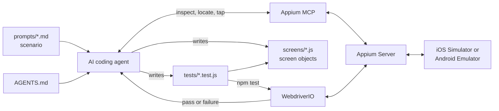

# ai-js-appium-mcp

An AI coding agent writes and runs WebdriverIO mobile UI tests for iOS and Android, using [Appium MCP](https://github.com/appium/appium-mcp) to inspect the running app.

[](https://github.com/yashwant-das/ai-js-appium-mcp/actions/workflows/lint.yml)
[](LICENSE)
[](https://webdriver.io)
[](https://github.com/appium/appium-mcp)
[](https://nodejs.org)

## Why it exists

Mobile UI tests are slow to write because finding stable locators means clicking through the app with an inspector. Here you describe a scenario in Markdown, and the agent does the inspecting through Appium MCP, writes the WebdriverIO test, runs it and fixes it until it passes. There is no generator, prompt parser or DSL: the Markdown prompt is the specification, and [AGENTS.md](AGENTS.md) tells the agent how to work.

[tests/create-contact.test.js](tests/create-contact.test.js) is a test an agent wrote from [prompts/create-contact.md](prompts/create-contact.md).

## Architecture



The agent explores the app through Appium MCP, writes a test, and runs it through WebdriverIO against the same Appium server; failures go back to the agent until the test passes.

## Quickstart

Prerequisites:

- Node.js 22+
- Appium Server with the XCUITest (iOS) or UiAutomator2 (Android) driver
- Xcode and an iOS Simulator, or the Android SDK and an emulator
- [Appium MCP](https://github.com/appium/appium-mcp), configured in an MCP-capable agent such as Claude Code, Cursor, OpenCode, Gemini CLI or Antigravity. Tested configurations are in [docs/appium-mcp-setup.md](docs/appium-mcp-setup.md).

```bash
git clone https://github.com/yashwant-das/ai-js-appium-mcp.git && cd ai-js-appium-mcp
nvm use                   # Node 24
npm install               # also installs Appium 3 and the XCUITest / UiAutomator2 drivers
cp .env.example .env      # your simulator name, iOS version and (optionally) UDID
npm run appium            # in a second terminal, with the simulator booted
npm test                  # runs every test against the app in app.config.js
```

A passing run ends with the spec reporter listing every test as passed. The app under test is set once in [app.config.js](app.config.js); no command needs an app ID. To have the agent write a new test, give it a prompt from `prompts/` (start new ones from [prompts/templates/prompt-template.md](prompts/templates/prompt-template.md)).

```bash
npm test -- --spec tests/create-contact.test.js   # one test
npm run test:android                               # Android (set android.* in app.config.js first)
npm run report                                     # build and open the Allure report
npm run test:unit                                  # unit tests for the support code
npm run clean                                      # delete test-results/ and Allure output
```

## Demo tests

The kit ships four Contacts tests, each written from a prompt in `prompts/`:

| Test | What it checks |
| --- | --- |
| [create-contact](tests/create-contact.test.js) | A new contact with phone and email is saved and found by search |
| [search-contact](tests/search-contact.test.js) | Search finds a contact by full name and by last name |
| [edit-contact](tests/edit-contact.test.js) | A changed phone number shows on the contact card |
| [delete-contact](tests/delete-contact.test.js) | A deleted contact no longer appears in search |

Every test creates contacts with unique names (`John Doe-<run id>`) and deletes them afterwards, so reruns start clean. Before each test the app is restarted and any leftover sheet, form or search is dismissed.

## Test reports and results

- CI runs ESLint on every push and pull request. The UI tests need a simulator or emulator, so they run locally, not in CI.
- The spec reporter prints results to the console; `npm run report` builds an Allure report from `allure-results/`. Failures attach a screenshot and the page source, also saved in `test-results/failures/`.
- Lint also rejects raw selectors in `tests/`: every locator lives in a screen object.
- CI also runs the unit tests for the support code (`npm run test:unit`).
- The lint rules that matter most for agent-written tests: `wdio/await-expect` (every assertion awaited), `wdio/no-debug` and `wdio/no-pause` (explicit waits only), and `chai-friendly/no-unused-expressions`. A Husky pre-commit hook runs them on staged files.

## Tech stack

| Layer | Tool | Version | Why |
| --- | --- | --- | --- |
| Test runner | WebdriverIO with Mocha | 10 | Standard Appium client for JavaScript |
| Device automation | Appium, XCUITest and UiAutomator2 | 3, 12, 8 | One API for iOS and Android; pinned as devDependencies and started with `npm run appium` |
| Agent tooling | Appium MCP | 1.97 | Lets the agent read page source, find locators and drive the app |
| Assertions | Chai and WebdriverIO expect | 6, 10 | Readable assertions with built-in waits |
| Reporting | Allure 3 with @wdio/allure-reporter | 3, 10 | Browsable report with failure screenshots; no Java needed |
| Quality gates | ESLint with eslint-plugin-wdio, Husky, lint-staged | 10, 9, 17 | Catches unawaited assertions and hard waits in generated code |

## Project structure

```text
├── AGENTS.md            # Workflow and rules for the AI agent
├── app.config.js        # The app under test
├── config/              # WDIO config: shared, iOS, Android
├── screens/             # Screen objects and shared flows
├── support/             # App reset, hooks, test data, cleanup, gestures
├── tests/               # Agent-written WebdriverIO tests
├── unit/                # node:test unit tests for support code and lint rules
├── prompts/             # Markdown test plans (templates/, archive/)
├── docs/                # Appium MCP setup, specs, plans, notes
└── eslint.config.js
```

## What this repo does and doesn't do

| Appium MCP | This repo |
|---|---|
| Creates and manages Appium sessions | WebdriverIO config, screen objects, app reset and cleanup |
| Finds UI elements and suggests locators | Markdown scenarios and the agent workflow in `AGENTS.md` |
| Reads page source and takes screenshots | Stores and runs the agent-written tests |
| Interacts with the app | Lint rules for generated code |

Not included: a prompt parser, code generator or DSL, and management of the Appium server, simulators, emulators or devices.

## Troubleshooting

- **`ECONNREFUSED 127.0.0.1:4723`**: Appium isn't running. Start it with `npm run appium`.
- **`No Android app configured`**: set `android.appPackage` and `android.appActivity` in `app.config.js`.
- **A test starts on the wrong screen**: add that screen to `dismissLeftovers` in `support/appState.js`.
- **`strict mode violation ... resolved to N elements`**: a locator matches more than one element. Make it unique in the screen object.
- **`npm audit` reports Appium advisories**: the remaining ones are inside the drivers' bundled dependencies and need upstream driver releases; `overrides` in `package.json` patch the rest.

## Documentation

- [docs/appium-mcp-setup.md](docs/appium-mcp-setup.md): tested Appium MCP configurations
- [docs/future-updates.md](docs/future-updates.md): planned improvements
- [AGENTS.md](AGENTS.md): how the agent writes, runs and fixes tests

## License

MIT. See [LICENSE](LICENSE).
