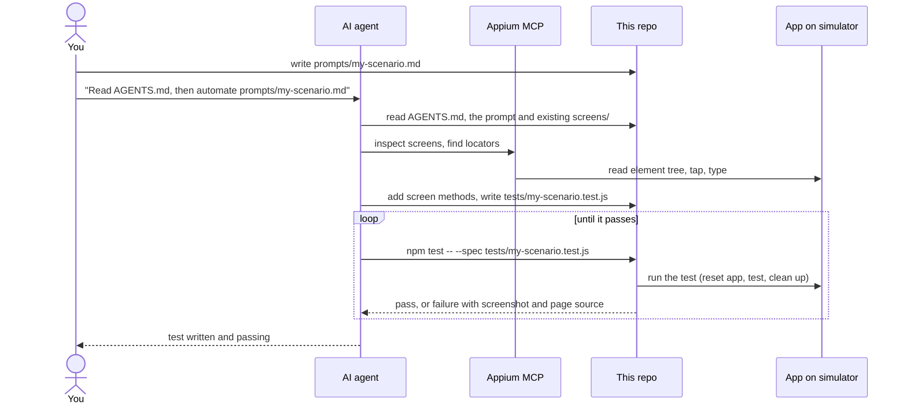

# ai-js-appium-mcp

You describe a mobile test in plain English. An AI coding agent turns it into a WebdriverIO test, runs it on a simulator or emulator, and fixes it until it passes. You keep the test and can run it any time, without the agent.

[](https://github.com/yashwant-das/ai-js-appium-mcp/actions/workflows/lint.yml)
[](LICENSE)
[](https://webdriver.io)
[](https://appium.io)
[](https://nodejs.org)

The repo ships ready to run against the iOS Contacts app, with four example tests. To test your own app, change one config file and replace the examples (see [Using it for your own app](#using-it-for-your-own-app)).

## Who does what

| Who | What they do |
| --- | --- |
| **You** | Boot a simulator or emulator, start Appium, write the scenario as a Markdown file in `prompts/`, ask the agent to automate it, review what it wrote. |
| **AI agent** (Claude Code, Cursor, OpenCode, Gemini CLI, …) | Follows [AGENTS.md](AGENTS.md): reads your scenario, looks at the running app through Appium MCP, writes screen-object methods and the test, runs it with `npm test`, and fixes it until it passes. |
| **[Appium MCP](https://github.com/appium/appium-mcp)** | The agent's eyes and hands while it writes a test: it reads the screen's element tree, suggests locators, taps and types. By default it drives the simulator with its own bundled drivers. It is only used while a test is being written, never when tests run. |
| **This framework** | Makes tests reliable and repeatable: one config for the app and device, screen objects that hold every locator, a reset to the app's home screen before each test, unique test data that is deleted afterwards, failure screenshots, an Allure report and lint rules for agent-written code. |
| **Appium server** (`npm run appium`) | Drives the app on the simulator or emulator when tests run with `npm test`. |

## How a test gets made



1. **You write the scenario** in `prompts/`: objective, steps, expected results. Start from [prompts/templates/prompt-template.md](prompts/templates/prompt-template.md).
2. **You ask the agent** to automate it.
3. **The agent inspects the app** through Appium MCP instead of guessing locators.
4. **The agent writes code** in two places: locators and actions go in a screen object under `screens/`, and the steps and assertions go in `tests/<scenario>.test.js`.
5. **The agent runs the test** with `npm test`. Before each test the framework restarts the app and returns it to the home screen. Afterwards it deletes any data the test created.
6. **If the test fails**, the agent reads the error, the failure screenshot and the page source, fixes the screen object or test, and runs it again.
7. **You get a passing test** that you can review, commit and rerun yourself.

## One-time setup

You need macOS with Xcode and an iOS Simulator (or the Android SDK and an emulator for Android apps), Node.js 24 and an MCP-capable AI agent.

```bash
git clone https://github.com/yashwant-das/ai-js-appium-mcp.git && cd ai-js-appium-mcp
nvm use                   # Node 24, from .nvmrc
npm install               # also installs Appium 3 and the XCUITest and UiAutomator2 drivers
cp .env.example .env      # set your simulator name, iOS version and (optionally) UDID
```

Then, each time you work with it:

```bash
npm run appium            # in its own terminal, with the simulator booted
npm test                  # optional: run the example tests to check everything works
```

Finally, connect Appium MCP to your agent once. [docs/appium-mcp.md](docs/appium-mcp.md) has the install steps, tested configs and how to check the agent can see it.

## Your first test

1. Copy the template and fill in the steps:

   ```bash
   cp prompts/templates/prompt-template.md prompts/add-favourite.md
   ```

   Set `test: tests/add-favourite.test.js` in its front matter and describe the steps in plain English, the way you'd explain them to a colleague. [prompts/edit-contact.md](prompts/edit-contact.md) is a complete example.

2. Open your agent in this folder and send it:

   > Read AGENTS.md, then automate prompts/add-favourite.md. Appium is running and the simulator is booted.

3. Let it work. You'll see it open an Appium MCP session, inspect screens, edit files under `screens/` and `tests/`, and run `npm test` until the test passes. It may ask before running commands, depending on your agent's settings.

4. Review the result:
   - `tests/add-favourite.test.js`: the steps and assertions, with no raw locators
   - `screens/*.js`: any new screen methods it added
   - `npm run lint`: should be clean

5. Run it yourself:

   ```bash
   npm test -- --spec tests/add-favourite.test.js
   ```

## Running tests yourself

Tests run on **iOS** by default: `npm test` and `npm run test:ios` are the same command, using the iOS Simulator set in `.env` and the bundle ID in `app.config.js`. Android is opt-in with `npm run test:android`.

```bash
# iOS (default)
npm test                                          # all tests
npm run test:ios                                  # same as npm test
npm test -- --spec tests/create-contact.test.js   # one test
WDIO_RETRIES=0 npm test                           # no automatic retry, to check a test is stable

# Android
npm run test:android                              # all tests (set android.* in app.config.js first)
npm run test:android -- --spec tests/my.test.js   # one test

# Reports and checks
npm run report                                    # build and open the Allure report
npm run test:unit                                 # unit tests for the framework's own code
npm run lint                                      # lint, including the agent-code rules
npm run clean                                     # delete test-results/ and Allure output
```

When a test fails, its screenshot and page source are saved to `test-results/failures/` and attached in the Allure report.

## Using it for your own app

1. Set your app in [app.config.js](app.config.js): `ios.bundleId`, and `android.appPackage` / `android.appActivity` if you test Android.
2. Set your device in `.env`.
3. Rewrite [support/appState.js](support/appState.js) for your app: its imports, `dismissLeftovers` (what your app can be left showing after a restart, such as onboarding or an open form) and the home screen `resetToHome` waits for. It imports the Contacts screens, so do this before deleting them.
4. Delete the Contacts screens, the contents of `screens/flows.js` and the files in `tests/`. Replace `uniqueContact` in `support/testData.js` with factories for your own data.
5. Write prompts for your app and give them to the agent, as in [Your first test](#your-first-test).

[docs/framework.md](docs/framework.md) explains each of these pieces.

## Example tests

| Test | Prompt | What it checks |
| --- | --- | --- |
| [create-contact](tests/create-contact.test.js) | [prompt](prompts/create-contact.md) | A new contact with phone and email is saved and found by search |
| [search-contact](tests/search-contact.test.js) | [prompt](prompts/search-contact.md) | Search finds a contact by full name and by last name |
| [edit-contact](tests/edit-contact.test.js) | [prompt](prompts/edit-contact.md) | A changed phone number shows on the contact card |
| [delete-contact](tests/delete-contact.test.js) | [prompt](prompts/delete-contact.md) | A deleted contact no longer appears in search |

Each test creates contacts named `John Doe-<run id>` and deletes them afterwards, so reruns start clean.

## Project structure

```text
├── AGENTS.md            # Instructions for the AI agent
├── app.config.js        # The app under test
├── .env.example         # Device and Appium settings (copy to .env)
├── prompts/             # Your scenarios in Markdown (templates/, archive/)
├── tests/               # Tests, one per scenario
├── screens/             # Screen objects (locators and actions) and shared flows
├── support/             # App reset, hooks, test data, cleanup, gestures
├── config/              # WebdriverIO config: shared, iOS, Android
├── unit/                # Unit tests for support code and lint rules
└── docs/                # Guides and design records
```

## Troubleshooting

- **`ECONNREFUSED 127.0.0.1:4723`**: Appium isn't running. Start it with `npm run appium`.
- **The agent says it has no Appium tools**: Appium MCP isn't connected. See [docs/appium-mcp.md](docs/appium-mcp.md).
- **`No Android app configured`**: set `android.appPackage` and `android.appActivity` in `app.config.js`.
- **A test starts on the wrong screen**: add that screen to `dismissLeftovers` in `support/appState.js`.
- **`strict mode violation ... resolved to N elements`**: a locator matches more than one element. Make it unique in the screen object.
- **`npm audit` reports Appium advisories**: the remaining ones are inside the drivers' bundled dependencies and need upstream driver releases; `overrides` in `package.json` patch the rest.

## Documentation

- [AGENTS.md](AGENTS.md): the workflow and rules the agent follows
- [docs/appium-mcp.md](docs/appium-mcp.md): connecting Appium MCP to your agent
- [docs/framework.md](docs/framework.md): how the framework works, for reviewing or extending agent-written code
- [docs/roadmap.md](docs/roadmap.md): planned improvements
- [docs/superpowers/](docs/superpowers/): design records (spec and implementation plan)

## Tech stack

| Layer | Tool | Version |
| --- | --- | --- |
| Test runner | WebdriverIO with Mocha | 10 |
| Device automation | Appium with the XCUITest and UiAutomator2 drivers (devDependencies) | 3, 12, 8 |
| Agent tooling | Appium MCP | tested with 1.97 |
| Reporting | Allure 3 with @wdio/allure-reporter (no Java needed) | 3, 10 |
| Quality gates | ESLint with eslint-plugin-wdio, Husky, lint-staged; CI runs lint and unit tests for pull requests to `master` | 10, 9, 17 |

## License

MIT. See [LICENSE](LICENSE).
