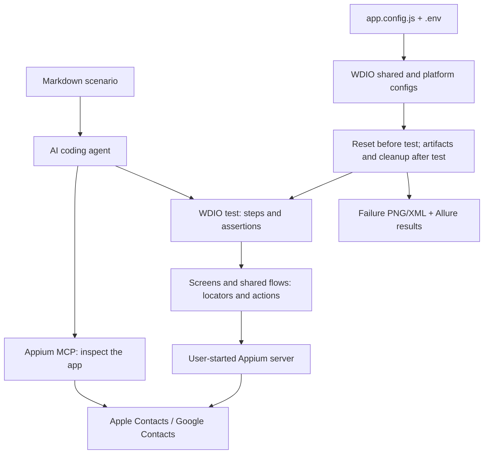

# Architecture

This guide is for people reviewing or extending the code the agent writes. It covers what happens during a test run and the conventions each folder follows. For the user workflow, see the [README](../README.md); for setup and maintenance, see [development](development.md).

## Components and boundaries



The agent interprets Markdown; the repository has no prompt parser, custom generator or test DSL. MCP is an external authoring dependency. Committed tests execute through WebdriverIO and the user-started Appium server without MCP or an AI agent.

`maxInstances: 1` serializes this WDIO runner’s sessions. It does not prevent a separate MCP client or runner from using the same device; coordinate those clients explicitly. The session uses `noReset: true`: app data persists, while the per-test reset terminates and activates the app and recovers known screens. This is navigation recovery, not a clean installation or a guarantee that all app state is erased.

Cleanup is best effort. Tasks run newest first and failures become warnings and Allure attachments; they do not fail an otherwise passing test. Failure artifact capture runs before cleanup; if screenshot capture itself throws, the current hook does not reach cleanup. Tests may therefore leave contacts behind after interrupted runs. These boundaries matter when diagnosing isolation problems.

## What happens when you run `npm test`

1. **Config loads.** `npm test` runs `config/wdio.ios.conf.js` (`npm run test:android` runs `config/wdio.android.conf.js`); both extend `config/wdio.shared.conf.js`. The app comes from `app.config.js` (through `support/appConfig.js`); the device and Appium address come from `.env`. Every file matching `tests/**/*.test.js` runs, one at a time.
2. **A session starts** on the Appium server with `appium:noReset: true`, so the app keeps its data between tests.
3. **`beforeTest` resets the app** (`support/appState.js`): it terminates and relaunches the app, dismisses anything a previous run or Appium MCP session left open, and waits for the home screen.
4. **The test runs.** It calls screen-object methods and makes assertions.
5. **`afterTest` handles the aftermath** (`support/hooks.js`): on failure it saves a screenshot and the page source to `test-results/failures/` and attaches both to the Allure report. Then it runs the test's cleanup tasks, newest first. A failing cleanup is logged and attached to the report, but never fails the test.
6. **Results** go to the console (spec reporter) and to `allure-results/`. `npm run report` turns those into a browsable report.

A failing test is retried once by default. Set `WDIO_RETRIES=0` to see failures without a retry.

## Folders and their rules

### `app.config.js`: the app under test

```js
module.exports = {
  name: 'Contacts',
  ios: { bundleId: 'com.apple.MobileAddressBook' },
  android: {
    appPackage: 'com.google.android.contacts',
    appActivity: 'com.android.contacts.activities.PeopleActivity'
  }
};
```

The only place the app is named. `APP_BUNDLE_ID`, `APP_PACKAGE` and `APP_ACTIVITY` override it if needed, but no command requires them. If the selected platform has no app configured, the config fails at load time with a message naming the field to set.

### `screens/`: screen objects

One file per screen, each exporting a single instance of a class that extends `BaseScreen`. A screen object holds the **locators and actions** for that screen and nothing else: no assertions.

```js
class ContactDetailScreen extends BaseScreen {
  get rootSelector() {
    return this.sel({ ios: '~ContactCardHeaderView', android: android.id('large_title') }, 'root');
  }

  get editButton() {
    return this.el({ ios: '~Edit', android: android.id('menu_insert_or_edit') }, 'editButton');
  }

  async tapEdit() {
    await this.tap(this.editButton);
  }
}
```

What `BaseScreen` gives every screen:

| Member | Purpose |
| --- | --- |
| `rootSelector` | An element that proves the screen is showing. Each screen overrides it. |
| `isIOS` | `true` on iOS. Use it inside a method when the two apps need different steps. |
| `sel({ ios, android }, label)` | Picks the locator for the platform under test. Throws `<Screen>.<label> has no <platform> locator` if one is missing. |
| `el(locators, label)` | `$(sel(...))`, the usual way to define an element. |
| `waitForDisplayed()`, `isDisplayed()` | Wait for, or check, the root element. |
| `tap(el)`, `type(el, text)` | Wait for the element, then click it, or clear it and type. |
| `tapIfVisible(el, timeout)` | Returns false if the visibility wait fails; clicks a visible element. Click errors propagate. |
| `scrollTo(el)` | Returns if already displayed; otherwise delegates to native `scrollIntoView` with a five-scroll limit. |

**Two platforms, one test.** Shared elements provide platform locators, and the screen picks the right one at run time. Platform-only controls (such as iOS’s add-phone button and Android’s delete-menu item) intentionally have a locator for just that platform and are accessed inside platform branches. When the apps' flows differ, the method branches internally and keeps one name. For example, `EditContactScreen.deleteContact()` scrolls to "Delete Contact" on iOS but opens the toolbar menu on Android, and `NewContactScreen.fill()` taps "add phone" only on iOS, because Android shows an empty phone field from the start. Tests never check the platform.

`screens/android.js` builds the Android selectors. The inspected Google Contacts UI used Compose elements with few resource IDs, so this implementation often locates controls by text: `android.id('large_title')`, `android.text('Save')`, `android.editText('First name')`, `android.scrollToText('Email')`.

Conventions:

- Locator priority: accessibility ID (`~name`), then iOS predicate string or class chain / Android resource ID, then XPath as a last resort.
- WebdriverIO 10 uses **strict selectors**: `$()` throws when a selector matches more than one element. Make locators unique, or use `$$()` inside the screen when several matches are expected (see `ContactsListScreen.waitForContactCount`).
- Methods that read something return it (`headerName()`, `phoneDigits()`); action methods return nothing.
- Actions wait for their own elements, so tests never wait on elements directly.

### `screens/flows.js`: multi-screen actions

Steps that cross several screens and are reused by several tests, such as `createContact(contact)` and `deleteContactByName(fullName)`. Cleanup tasks use them too.

### `tests/`: one file per scenario

A test reads like its prompt: it calls screens and flows, and makes every assertion.

```js
it('updates a contact phone number', async function () {
  const contact = uniqueContact();
  const newPhone = uniqueContact().phone;
  registerCleanup(`delete ${contact.fullName}`, () => deleteContactByName(contact.fullName));

  await createContact(contact);
  expect(await ContactDetailScreen.phoneDigits()).toBe(contact.phone);

  await ContactDetailScreen.tapEdit();
  await EditContactScreen.setPhone(newPhone);
  await EditContactScreen.save();

  expect(await ContactDetailScreen.phoneDigits()).toBe(newPhone);
});
```

Rules, some enforced by lint:

- No raw selectors (`$`, `$$`, `browser.$`, `driver.$`). Lint fails with "Use a screen object method instead of a raw selector."
- No app reset in the test; `beforeTest` does it.
- Generated data, not fixed names, and a cleanup registered **before** the data is created, so it remains queued if the test fails halfway. The after-test hook attempts cleanup; an interrupted run or artifact-capture error can prevent it.

### `support/`: shared machinery

| File | What it does |
| --- | --- |
| `appConfig.js` | `resolveApp(platform)` reads `app.config.js` and env overrides. |
| `appState.js` | `restartApp()`, `dismissLeftovers()` and `resetToHome()`. **App-specific:** `dismissLeftovers` knows which Contacts screens can be left open, and `resetToHome` waits for the contacts list. |
| `hooks.js` | `beforeTest` (reset) and `afterTest` (failure artifacts, then cleanup). |
| `testData.js` | `uniqueContact(overrides)` returns `{ first, last, phone, email, fullName }` with a last name like `Doe-<runId><n>`, using a process-start timestamp and per-process counter to reduce collisions; cross-process uniqueness is not guaranteed if processes start in the same millisecond. |
| `cleanup.js` | `registerCleanup(name, fn)` queues a task; `afterTest` runs the queue newest first. |
| `gestures.js` | `tapIfVisible` and `scrollTo`, used by `BaseScreen`. |

### `config/`: WebdriverIO configuration

| File | What it holds |
| --- | --- |
| `wdio.shared.conf.js` | Runner, Mocha, timeouts, retries, reporters (spec and Allure), Appium address, hooks |
| `wdio.ios.conf.js` | XCUITest capability: `IOS_*` values from `.env`, bundle ID from `app.config.js` |
| `wdio.android.conf.js` | UiAutomator2 capability: `ANDROID_*` values from `.env`, package and activity from `app.config.js`, and `appium:hideKeyboard` so keyboard onboarding sheets (such as Gboard's stylus prompt) never cover the app |

### `prompts/`: scenarios

One Markdown file per test, with `test: tests/<scenario>.test.js` in the front matter. `prompts/templates/` holds the template; `prompts/archive/` keeps old prompts for other apps.

### `unit/`: tests for the framework itself

`node:test` tests for the pure modules (`appConfig`, `testData`, `cleanup`), the raw-selector lint rule and text/config validation. Run them with `npm run test:unit`; they need no device.

## Lint rules for agent-written code

| Rule | Why |
| --- | --- |
| No raw selectors in `tests/` | Keeps every locator in one place, so a UI change means one fix |
| `wdio/await-expect` | An unawaited async assertion silently passes |
| `wdio/no-pause` | Fixed sleeps make tests slow and flaky; wait for elements instead |
| `wdio/no-debug` | `browser.debug()` hangs a test run |
| `chai-friendly/no-unused-expressions` | Catches assertions that are written but never evaluated |

Husky checks staged code, Markdown, formatting and text/config hygiene. CI independently checks the full maintained scope and runs offline unit tests; see [quality gates](development.md#quality-gates).

## Adding a new screen

1. Create `screens/MyScreen.js` extending `BaseScreen`, with a `rootSelector` that is unique to that screen.
2. Define elements with `this.el({ ios: '...', android: '...' }, 'name')`. Fill in the platforms you test; a missing one fails with `<Screen>.<name> has no <platform> locator`.
3. Add action methods that wait for their elements (`this.tap`, `this.type`) and read methods that return values.
4. If the app can be left on this screen after a restart, teach `dismissLeftovers` in `support/appState.js` how to leave it.
